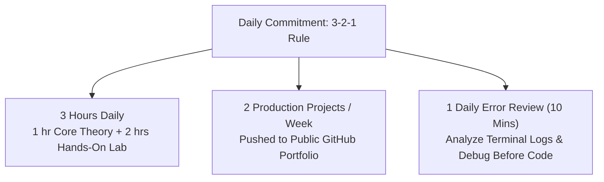
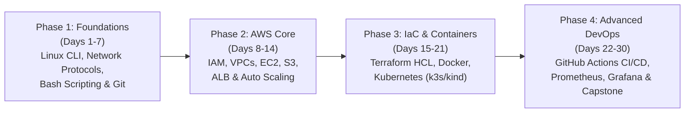

# Think Polaris Cloud & DevOps Engineer 30-Day Mastery Track
## Zero to Production Infrastructure: Linux, Networking, AWS, Terraform, Docker, Kubernetes & Observability

> **Classification**: Technical Curriculum & Practitioner Training Track  
> **Target Audience**: College Interns, Aspiring Junior Cloud & DevOps Engineers  
> **Training Location**: Alwaye (Aluva), Kerala — Think Polaris Technical Center  
> **Delivery Model**: Hybrid Hands-On (WSL2 / PowerEdge Lab Server + AWS Free Tier)  
> **Pace**: 30 Days (2.5 to 3.5 Hours/Day)  
> **Cost Guarantee**: $0.00 Out-of-Pocket (Strict Zero-Dollar Shield & Free Tier Guardrails)

---

## 1. Executive Summary & Purpose

The **Think Polaris Cloud & DevOps Engineer 30-Day Mastery Track** is an intensive, hands-on, practitioner-grade engineering syllabus designed to bridge the gap between academic theory and real-world infrastructure engineering.

While our foundational IT program focuses on enterprise identity, on-premise systems administration, and ITSM service desk workflows (Active Directory, GLPI, pfSense, Veeam), this standalone track trains interns in modern **Cloud Architecture, Infrastructure as Code (IaC), Containerization, Kubernetes Orchestration, CI/CD, and Site Reliability Engineering (SRE)**.

Interns transition from the command line to provisioning self-healing, multi-tier cloud applications deployed through automated code pipelines.

---

## 2. The 3-2-1 Discipline System

To guarantee enterprise job-readiness within 30 days without academic burnout, every cohort follows the strict **3-2-1 Rule**:



1. **3 Hours / Day**:
   - **1 Hour Theory & Architecture**: Deep-dive into protocols, failure domains, and design tradeoffs.
   - **2 Hours Hands-On Labs**: High-intensity command-line execution, configuration, and debugging.
2. **2 Portfolio Milestones / Week**:
   - Every week concludes with production-grade artifacts committed to public GitHub repositories (Day 7, Day 14, Day 21, and Day 30).
3. **1 Error Audit / Day**:
   - 10-minute root cause review before every session: inspect yesterday's failed builds, stack traces, and exit codes.

---

## 3. Four-Phase Chronological Curriculum Roadmap



### Phase 1: Systems & Networking Foundations (Days 1–7)
*Objective*: Build absolute fluency in the Unix shell, POSIX utilities, and TCP/IP networking fundamentals.
- **Day 1–2**: Linux CLI mastery (`grep`, `awk`, `sed`, `chmod`, `systemctl`, process management, SSH keys).
- **Day 3–4**: Cloud networking mechanics (Subnetting, CIDR, DNS resolution, HTTP/S headers, firewalls, `tcpdump`, `traceroute`).
- **Day 5–6**: Defensive Bash scripting, version control workflows, Git branching, and GitHub documentation standards.
- **Day 7 [Milestone 1]**: Automated Health & Backup Daemon (custom Bash tool with logging, exit traps, and alerting).

### Phase 2: AWS Core Cloud Architecture (Days 8–14)
*Objective*: Master cloud primitives on AWS Free Tier while enforcing the Zero-Dollar Shield.
- **Day 8–9**: Identity and Access Management (IAM least-privilege, RBAC, MFA) & Virtual Private Clouds (VPC, public/private subnets, routing tables, security groups).
- **Day 10–11**: Elastic Compute Cloud (EC2), Elastic Block Store (EBS), S3 object storage policies, and CLI automation.
- **Day 12–13**: Elastic Load Balancing (Application Load Balancer), target groups, health checks, and Auto Scaling Groups (ASG).
- **Day 14 [Milestone 2]**: High-Availability Resilient Web Architecture (CloudFront CDN + S3 Origin + SSL via ACM + Auto Scaling EC2 fleet).

### Phase 3: Infrastructure as Code & Containers (Days 15–21)
*Objective*: Transition from manual console clicking to programmatic, version-controlled cloud infrastructure and microservices.
- **Day 15–16**: Terraform deep-dive (HashiCorp Configuration Language `HCL`, state management, modules, input/output variables, zero-drift patterns).
- **Day 17–18**: Docker containerization (multi-stage `Dockerfile`, image optimization, networking, multi-container `docker-compose`).
- **Day 19–20**: Kubernetes orchestration fundamentals (Pods, Deployments, ClusterIP/NodePort Services, ConfigMaps, Secrets, `k3s`/`kind`).
- **Day 21 [Milestone 3]**: Automated Containerized Workload (Terraform provisions infrastructure → deploys containerized app to Kubernetes cluster).

### Phase 4: Production DevOps, Observability & Capstone (Days 22–30)
*Objective*: Tie code, cloud, and runtime together with enterprise CI/CD automation, telemetry, and least-privilege security.
- **Day 22–23**: CI/CD pipelines with GitHub Actions (Linting, automated test runs, Docker Hub push, GitOps deployment triggers).
- **Day 24–25**: Modern Cloud Observability (Prometheus metric scraping, Alertmanager rules, Grafana dashboard visualization).
- **Day 26–27**: Cloud Security, IAM governance, CloudTrail audit logging, AWS Trusted Advisor, and cost optimization.
- **Day 28**: Cloud Databases & Serverless (RDS vs. DynamoDB, AWS Lambda event-driven processing).
- **Day 29–30 [Capstone]**: **Production 3-Tier Enterprise Web Application on AWS & Kubernetes**:
  - React Frontend & Python FastAPI Backend running in Docker on Kubernetes.
  - RDS PostgreSQL database in an isolated private subnet.
  - 100% provisioned via Terraform with zero manual console edits.
  - End-to-end GitHub Actions CI/CD deployment on git push.
  - Verification: Complete `terraform destroy` followed by a single-command rebuild (`terraform apply`).

---

## 4. The Zero-Dollar Shield (Cost Protection Model)

To eliminate unexpected AWS bills and banking verification hurdles for students in Alwaye, this track enforces four cost guardrails:

| High-Cost Trap | Standard AWS Expense | Think Polaris Zero-Cost Alternative | Savings / Student |
| :--- | :--- | :--- | :--- |
| **AWS NAT Gateway** | ~$32.40 / month + data transfer | Free `t2.micro` NAT Instance or Dual-Homed Public Routing | ~$35 / month |
| **AWS EKS Control Plane** | $0.10 / hour ($72.00 / month) | Local `kind` or `k3s` on Free-Tier EC2 / WSL2 / PowerEdge Lab VM | $72 / month |
| **AWS Application Load Balancer** | ~$16.20 / month idle | Ephemeral testing (1–2 hrs) or Nginx ingress controller | ~$16 / month |
| **Orphaned EBS Volumes & Elastic IPs** | $0.005 / hour unused IP | Mandatory End-of-Day Teardown Checklist (`terraform destroy`) | Complete bill prevention |

*All students activate AWS CloudWatch $1.00 and $5.00 billing alarms and AWS Budgets on Day 8 prior to launching any cloud resource.*

---

## 5. Lab Execution Architecture: Dual-Path Hybrid Standard

Students have two flexible options for executing Linux, container, and cloud automation tasks:

```
+-----------------------------------------------------------------------------------------+
|                                     STUDENT LAPTOP                                      |
|                                                                                         |
|   +---------------------------------------+   +-------------------------------------+   |
|   |         PATH A: LOCAL WORKSTATION     |   |       PATH B: BARE-METAL LAB VM     |   |
|   |   - Windows 10/11 + WSL2 (Ubuntu 22)  |   |   - Dell PowerEdge R640 Proxmox VM  |   |
|   |   - Docker Desktop / Rancher Desktop  |   |   - Dedicated Cloud-Init Ubuntu 22  |   |
|   |   - VS Code Remote-WSL                |   |   - Internal Bridge vmbr1 (10.10.x) |   |
|   |   - Terraform, AWS CLI, kubectl, k3s  |   |   - High-throughput multi-core      |   |
|   +---------------------------------------+   +-------------------------------------+   |
+-----------------------------------------------------------------------------------------+
                                            |
                                            v
                     +---------------------------------------------+
                     |           AWS FREE TIER (Public Cloud)      |
                     |  - IAM, S3, CloudFront, ACM, Lambda         |
                     |  - Ephemeral EC2 t2.micro, DynamoDB         |
                     |  - Protected by Zero-Dollar Shield          |
                     +---------------------------------------------+
```

1. **Path A (Local Mobility)**: Windows 10/11 Laptop with WSL2 (Ubuntu 22.04 LTS), Docker, and VS Code Remote-WSL. Allows students to practice from home or campus.
2. **Path B (Classroom Dell PowerEdge R640)**: Individual, pre-configured Ubuntu 22.04 Cloud-Init VMs hosted on the lab's bare-metal PowerEdge server on internal bridge `vmbr1` (`10.10.10.x`), accessed via SSH and VS Code Remote-SSH.

---

## 6. Directory Structure & Quick Links

- [00_SETUP_AND_PREREQUISITES.md](file:///d:/optimistic-meitner/cloud-devops-track/00_SETUP_AND_PREREQUISITES.md): Complete workstation setup, WSL2 configuration, AWS Free Tier creation, and Zero-Dollar Shield setup.
- [DAILY_SCHEDULE_MATRIX.md](file:///d:/optimistic-meitner/cloud-devops-track/DAILY_SCHEDULE_MATRIX.md): Detailed day-by-day matrix outlining theory, lab tasks, deliverables, and self-test questions.
- [labs/day-01-linux-foundations/](file:///d:/optimistic-meitner/cloud-devops-track/labs/day-01-linux-foundations/): Day 1 Linux CLI exercises, environment verification script (`verify_environment.sh`), and defensive backup script (`backup_home.sh`).
